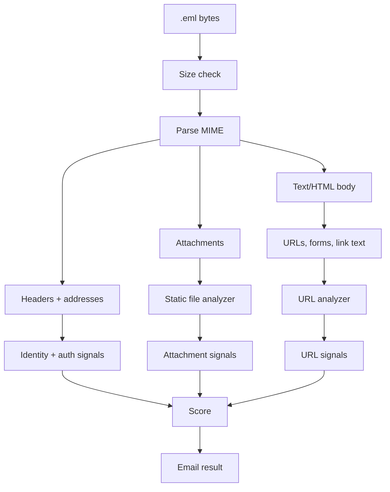

# PhishGuard — Architecture

> **Style:** modular monolith for the public MVP. One Streamlit process, isolated analyzer modules, no database, in-memory processing only.

---

## 1. Design goals

1. **One result shape** for every input type.
2. **Explainable** scores: every point maps to a visible signal.
3. **Safe by default**: no execution, no page fetch, no storage.
4. **Optional enrichment**: threat intelligence is opt-in and failure-tolerant.
5. **Testable**: analyzers are pure functions over bytes/text plus an optional intel client.
6. **Evolvable**: the same analyzers can sit behind a FastAPI service later.

---

## 2. Component map

```text
┌─────────────────────────────────────────────────────────────────────┐
│                            app.py                                   │
│  Streamlit UI · tabs · upload limits · rate limit · result render   │
└───────────────┬─────────────────────────────────────────────────────┘
                │
                │ calls analyzer functions
                ▼
┌─────────────────────────────────────────────────────────────────────┐
│                    src/phishguard/analyzers/                        │
│  url.py · email.py · qr.py · file.py · social.py                    │
└───────┬───────────────┬───────────────┬───────────────┬─────────────┘
        │               │               │               │
        ▼               ▼               ▼               ▼
   utils.py         intel.py        models.py       scoring.py
 DNS/TLS/RDAP    VT/GSB/urlscan   Signal/Result   score/verdict
 SSRF guard       TTL cache        enums           recommendations
```

### Responsibilities

| Module | Owns | Does not own |
| --- | --- | --- |
| `app.py` | UI, session state, limits, rendering | detection logic |
| `analyzers/url.py` | URL signals + network enrichment | email parsing |
| `analyzers/email.py` | MIME parsing, headers, auth, links, attachments | file execution |
| `analyzers/qr.py` | image decode + URL handoff | image editing |
| `analyzers/file.py` | static file inspection | sandboxing |
| `analyzers/social.py` | text patterns + link handoff | platform scraping |
| `scoring.py` | aggregation, thresholds, actions | collecting evidence |
| `utils.py` | safe network/file primitives | business logic |
| `intel.py` | third-party reputation | local heuristics |

---

## 3. Directory layout

```text
PhishGuard/
├── app.py
├── requirements.txt
├── .env.example
├── .streamlit/
│   └── config.toml
├── src/
│   └── phishguard/
│       ├── __init__.py
│       ├── models.py
│       ├── scoring.py
│       ├── utils.py
│       ├── intel.py
│       └── analyzers/
│           ├── __init__.py
│           ├── url.py
│           ├── email.py
│           ├── qr.py
│           ├── file.py
│           └── social.py
├── tests/
│   ├── test_scoring.py
│   ├── test_url.py
│   ├── test_email.py
│   ├── test_qr.py
│   ├── test_file.py
│   └── test_social.py
├── samples/
│   ├── benign/
│   └── phishing/
├── reports/            # generated locally, gitignored
├── screenshots/
├── documentation/
└── README.md
```

---

## 4. Core data model

### `Signal`

```python
@dataclass(frozen=True)
class Signal:
    id: str                 # stable, unique, e.g. "url.brand_lookalike"
    title: str              # short user-facing label
    severity: Severity      # info | low | medium | high | critical
    category: str           # url | email | credentials | attachment | qr | social | intel | file
    description: str        # why it matters
    evidence: str = ""      # the actual value/observation
    weight: int = 0         # 0–100
    confidence: float = 1.0 # 0–1
    source: str = "heuristic"  # heuristic | VirusTotal | ...
```

Rules:

- IDs are stable and namespaced (`url.*`, `email.*`, `file.*`).
- Evidence is short and redacted where needed.
- Weight is the maximum contribution; confidence scales it.
- Info signals have weight 0 and exist to show “checked”.

### `AnalysisResult`

```python
@dataclass
class AnalysisResult:
    analyzer: str
    target: str
    score: int
    verdict: Verdict
    summary: str
    signals: list[Signal]
    metadata: dict
    recommendations: list[str]
    confidence: float
    error: str | None
```

Every analyzer returns this. The UI never needs to know which analyzer produced it.

### JSON shape

```json
{
  "analyzer": "URL",
  "target": "http://paypa1.com/login",
  "score": 50,
  "verdict": "suspicious",
  "verdict_label": "Suspicious",
  "summary": "...",
  "confidence": 0.68,
  "signals": [
    {
      "id": "url.brand_lookalike",
      "title": "Domain closely resembles a known brand",
      "severity": "high",
      "category": "url",
      "description": "...",
      "evidence": "paypa1.com",
      "weight": 35,
      "confidence": 1.0,
      "source": "heuristic"
    }
  ],
  "metadata": {},
  "recommendations": [],
  "error": null
}
```

---

## 5. Scoring engine

```text
1. Deduplicate signals by id, keeping the highest weight.
2. score = min(100, round(Σ(weight × confidence)))
3. verdict:
     70+                  -> malicious
     35–69                -> suspicious
     <35 with signals     -> likely_safe
     no signals / no data -> unknown
4. confidence = rough function of signal count, category diversity, metadata
5. recommendations = category-aware action list
```

### Why additive, not average?

Averages hide a single critical signal. Additive with a cap lets one confirmed malware hit dominate, while still allowing several medium signals to add up.

### Why the critical floor?

`verdict_for()` treats a critical signal with score ≥ 50 as malicious. This prevents a single critical signal from being diluted by many benign info signals.

### Tuning

- Add a signal with a weight and a test.
- If a rule is noisy, lower its weight or confidence; do not delete it without a replacement.
- Keep a `tests/fixtures` set of known benign and malicious samples.
- Re-run the beta feedback loop after every tuning change.

---

## 6. URL analyzer flow

```mermaid
flowchart TD
    A[Raw URL] --> B[Normalize / refang]
    B --> C{Valid http(s)?}
    C -- no --> D[Unsupported scheme signal]
    C -- yes --> E[Lexical signals]
    E --> F{Online?}
    F -- no --> G[Score]
    F -- yes --> H[Resolve public IPs]
    H --> I{Private/reserved?}
    I -- yes --> J[Critical SSRF signal]
    I -- no --> K[DNS records]
    K --> L[RDAP domain age]
    L --> M[TLS certificate via pinned IP]
    M --> N{Intel opted in?}
    N -- yes --> O[VirusTotal / GSB / urlscan]
    N -- no --> G
    O --> G
    J --> G
    G --> P[AnalysisResult]
```

### Security invariant

The app **never** calls `requests.get()` on the user-supplied URL and never renders it. The only outbound connections are:

- DNS resolution,
- a TLS handshake to a validated public IP,
- RDAP,
- explicitly enabled threat-intelligence APIs.

This prevents SSRF and browser-based malware exposure.

---

## 7. Email analyzer flow



### Parsing rules

- Use `policy.default` for modern header decoding.
- Never render HTML; parse with BeautifulSoup and extract text/links/forms.
- Limit body to ~2 MB and attachments to 10 MB each, 5 attachments.
- Do not load remote images.
- Do not execute or extract attachments.

### Authentication caveat

PhishGuard parses the receiving server’s `Authentication-Results` and checks the domain’s DMARC DNS record. It does not perform a full independent SPF/DKIM verification of the raw message (which requires the connecting IP, selector, and canonicalization). Document this limitation.

---

## 8. File analyzer flow

```text
bytes + filename
   │
   ├─ size / hash / magic
   ├─ extension vs content
   ├─ executable/LNK/ISO/OneNote/RTF signatures
   ├─ OLE streams (VBA, EncryptionInfo)
   ├─ OOXML zip entries (vbaProject.bin, embeddings, externalLinks, ActiveX)
   ├─ PDF actions (/JavaScript, /Launch, /EmbeddedFile, /OpenAction)
   ├─ ZIP metadata (entries, ratio, traversal, encryption, executables)
   └─ script/HTML patterns (PowerShell, base64, iframe, HTML smuggling)
   │
   └─ optional VirusTotal hash lookup
```

### Hard limits

- 25 MB analyzer limit; 10 MB public upload limit.
- 2,000 archive entries inspected.
- 200 MB uncompressed archive ceiling for the bomb check.
- No extraction to disk.
- No nested archive recursion beyond one level.

---

## 9. QR analyzer flow

```text
image bytes → OpenCV decode (in memory)
   ├─ no QR → error result
   ├─ URL → URL analyzer → merge signals
   └─ non-URL text → payment/credential keyword check
```

The decoded value is shown to the user **before** they open it.

---

## 10. Social analyzer flow

```text
text + platform
   ├─ pattern groups (crypto, prize, urgency, credentials, impersonation, off-platform, job, too-good)
   ├─ brand + support impersonation
   ├─ URL extraction → URL analyzer
   └─ score + recommendations
```

No scraping, no login, no platform API. This keeps the tool legal and deployable.

---

## 11. Configuration

| Variable | Default | Purpose |
| --- | --- | --- |
| `VIRUSTOTAL_API_KEY` | empty | URL/file reputation |
| `GOOGLE_SAFE_BROWSING_API_KEY` | empty | URL threat match |
| `URLSCAN_API_KEY` | empty | higher urlscan quota |
| `PHISHGUARD_MAX_UPLOAD_MB` | `10` | public upload limit |
| `PHISHGUARD_RATE_LIMIT` | `20` | analyses per session per hour |
| `PHISHGUARD_REPO_URL` | repo URL | sidebar links |

Streamlit Cloud: set these in **App settings → Secrets**. Locally: `.env` or exported environment variables.

---

## 12. Error handling

- Analyzer errors return `AnalysisResult(error=...)`, not a traceback.
- Network timeouts are caught and recorded in `metadata["intel_errors"]`.
- A missing API key is “not configured”, not a failure.
- A missing QR is an error result, not a crash.
- Malformed files return a safe error result.
- The UI shows a friendly message and still renders any partial signals.

---

## 13. Caching

- Intel results: 15-minute in-process TTL cache.
- No caching of raw uploads, email bodies, or files.
- Public URL results are not cached across users in the MVP; this avoids accidental data retention.
- If you add a shared cache later, store only the URL/hash and result, with a short TTL, and document it in the privacy policy.

---

## 14. Future FastAPI split

When the monolith is genuinely limiting, add:

```text
POST /v1/analyze/url
POST /v1/analyze/email
POST /v1/analyze/file
POST /v1/analyze/qr
POST /v1/analyze/social
GET  /health
```

Request/response shape mirrors `AnalysisResult`. Add:

- Redis for intel cache and rate limits.
- A job queue for large files.
- Auth/API keys for programmatic users.
- A separate worker with no inbound internet except approved intel APIs.
- A frontend (Next.js or Streamlit) calling the API.

Do not split until you have a concrete reason (traffic, background jobs, multiple clients).

---

## 15. Extension points

### Add a new URL signal

1. Add a `Signal` in `_lexical_signals()` or `_network_signals()`.
2. Add a test in `tests/test_url.py`.
3. Tune the weight against benign/malicious samples.
4. Update the README feature table if user-visible.

### Add a new file type

1. Add a signature in `utils.detect_mime()`.
2. Add a parser branch in `analyzers/file.py`.
3. Add a test with a synthetic sample.
4. Document the limitation.

### Add a new language for social scams

1. Add a pattern group with validated terms.
2. Have a native speaker review for false positives.
3. Add benign and malicious tests.
4. Do not use grammar as a signal.

---

## 16. Architecture decisions (ADR-style)

| Decision | Rationale | Trade-off |
| --- | --- | --- |
| Streamlit monolith | Fast public MVP, free hosting | Limited rate limiting and background jobs |
| No database | Privacy, simplicity | No history or shared cache |
| No page fetch | Avoid SSRF/malware exposure | Less information than a sandbox |
| Static file analysis | Safe and deployable | No zero-day detonation |
| Additive scoring | Explainable and tunable | Requires careful weighting |
| Intel opt-in | Privacy and quota control | Some users get less coverage |
| Rule-based first | Transparent, testable, no labels needed | Less coverage than a trained ML model |
| No platform APIs | Legal/simplicity | Social analysis is text-only |

---

## 17. Definition of done for architecture changes

- The change keeps the `AnalysisResult` contract.
- It does not add storage or execution.
- It has a test or a documented manual check.
- It degrades gracefully when a dependency fails.
- It is documented in this file or the README.
